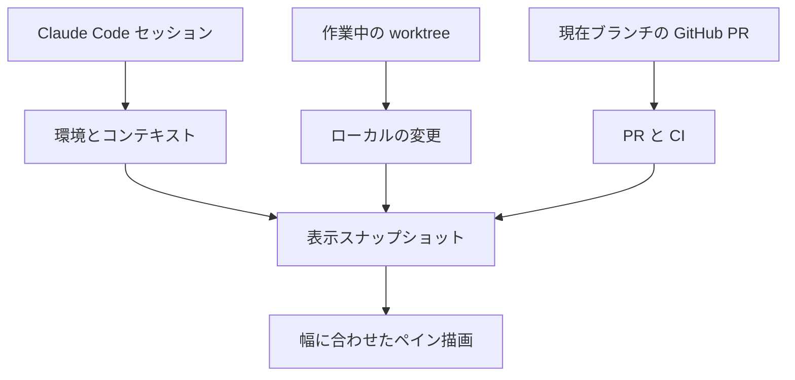
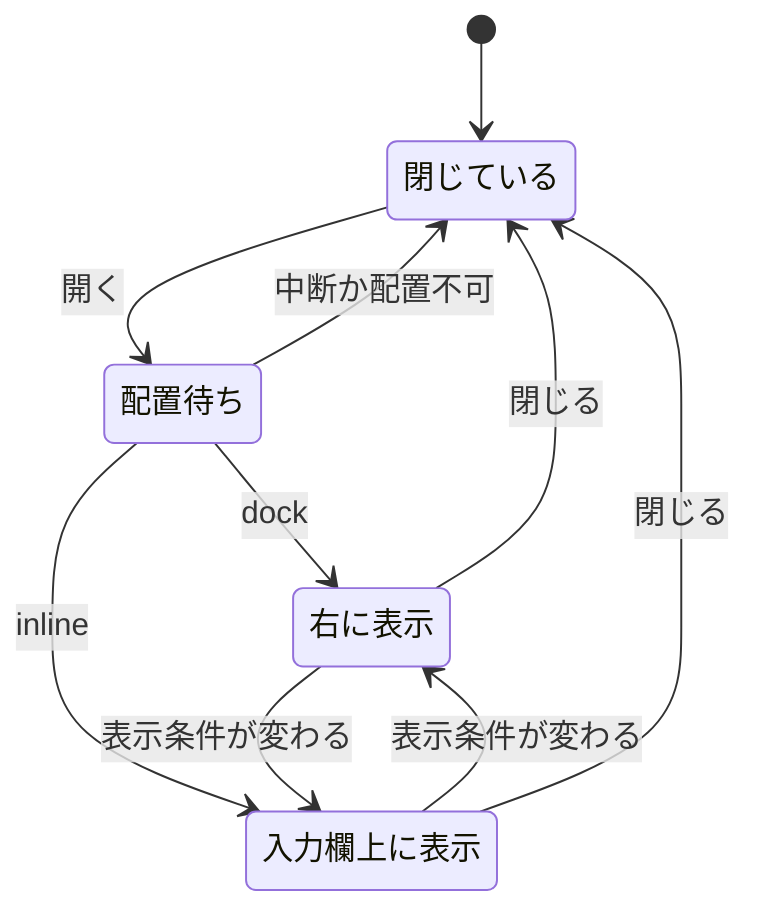

# Claude Code CLI セッションサイドバー 実装計画

- 対象リポジトリは [DIO0550/claude-mods-lab](https://github.com/DIO0550/claude-mods-lab)
- 2026年11月27日時点の `main` は [初期コミット `490ea78`](https://github.com/DIO0550/claude-mods-lab/commit/490ea78d3c73b9a5589948756f30188eb4fdf8a6)。`.gitignore`、`LICENSE`、`README.md` のみ
- 見た目と操作の基準は [画面デザイン](design.html)
- 仮の Mod 名は `session-rail`。起動コマンドは `/rail`

## 1. 作るもの

Claude Code CLI で会話を続けながら、**今のセッションの環境・コンテキスト・変更**を確認できる Mod を自作する。Claude Desktop の右側を UI の参考にし、CLI のペインを使う。左側の案は、進行中のサブエージェントと現在の作業ツリーを見渡すための探索エリアとする。

| 範囲 | 完成形 |
| --- | --- |
| 初版 | `/rail` で開閉。ワイド表示では右側、狭い表示では入力欄上に要約。環境、コンテキスト、ローカル差分、PR と CI の状態を表示 |
| 初版の詳細 | コンテキストを展開して色別の内訳を表示。PR 全体と未コミット差分を別に扱い、「変更」から詳細に進める |
| 次の版 | 同じ Mod ペインに「概要」「サブエージェント」「ファイル」を追加。初版の概要は維持 |
| 将来の構想 | 左に探索、中央に会話、右に概要を常駐。現行の公開 Mods API に左ペインを指定する方法がないため、必要になった時点で tmux などの外側 UI を別の検証にする |

Desktop 本体の変更、別セッションへの切り替え、埋め込みブラウザ、埋め込みターミナル、自前エディタは今回の範囲外。ファイルの初版は閲覧のみとする。

## 2. 最初に実機で確かめる

実装は `plugins/session-rail/` に置く。`node --test "plugins/**/__tests__/*.ts"` で開閉、実データの表示、Git の集計を確認できる。以下は Claude Code 実機での確認手順。

型定義やモックだけでは、ペインの位置、フォーカス、組み込みコマンドの起動までは確定できない。まず、Mod をローカルで読み込み、開閉と配置から確かめる。

```bash
claude --version
claude plugin validate ./plugins/session-rail
claude --plugin-dir ./plugins/session-rail
```

1. `/rail` を入力し、環境・コンテキスト・変更の見出しと現在の作業先を確認する。
2. fullscreen の広い端末、狭い端末、classic 表示で `e.props.placement` と `bodyColumns` を確認する。Mod 側で列数を決め打ちして配置しない。
3. 再実行やユーザーの閉じる操作で状態が残らないこと、Tab と Enter で操作できて入力欄へ戻れることを確認する。作業中に開く動作は、コマンド登録の `immediate` も含めて試す。
4. 同じ実機で `$.session.usage({ breakdown: "summary" })` の利用可否、`$.command.run` からの `/diff` 起動を個別に確認する。使えない場合の代替は第4節のとおり。

検証時の Claude Code バージョンと端末条件を README に記録し、動作確認できた版を初版の基準にする。HTML の動作は CLI での実機検証に含めない。

## 3. 設計とリポジトリ構成

**セッションの状態と判断、取得の手順、外部 API との接続、表示を分ける。** `ui.render` は現在のスナップショットを描くだけにして、Git や `gh` を毎回起動しない。レイアウトを入れ替えても同じデータを使えるようにする。





コンテキストの展開やタブの選択は、ペインの開閉とは別の表示状態。環境、コンテキスト、ローカル差分、PR は個別に準備中・取得済み・対象なし・取得不可を持つ。一つの取得に失敗しても、他のセクションは表示する。

| 置き場所 | 役割 |
| --- | --- |
| `plugins/session-rail/.claude-plugin/plugin.json` | Mod の名前と説明 |
| `plugins/session-rail/hooks/hooks.json` | hooks module の入口を指定 |
| `plugins/session-rail/hooks/register.ts` | ホストのイベントを登録し、内部イベントに変換する入口 |
| `plugins/session-rail/src/domain/` | セッションの事実を表す `SessionEvent`、コンテキスト使用量、worktree、ローカル差分の型と判断 |
| `plugins/session-rail/src/application/` | `RailEvent` を受けて取得・クリアを判断し、`RailSnapshot` を更新する。取得元は `SummarySources` で受け取る |
| `plugins/session-rail/src/infrastructure/claude-code/` | Claude Code のセッション API とコマンド実行を取得元につなぐ |
| `plugins/session-rail/src/infrastructure/git/` | worktree を検出し、Git のコマンド出力をドメインの値に変換する |
| `plugins/session-rail/src/presentation/` | 表示文言、行数、コンパクト表示と詳細表示の組み立て |
| 対象の `.ts` に隣接する `__tests__/` | 各層の単体テスト、実 Git を使うテスト、Mod の結合テスト。`対象.カテゴリ.ts` で分け、`describe` は使わない |
| `docs/session-rail/` | 実装計画と HTML の画面案 |

`domain` は外部 API と描画に依存しない。`application` は `domain` と自分が定義した取得口だけに依存し、Claude Code や Git を直接呼ばない。たとえば Git が返す detached HEAD はドメインではコミット ID として保持し、7 桁に短くするのは表示側だけで行う。`LocalChanges` は変更なし・未追跡のみ・追跡済みの変更を区別する。行数を数えられない状態は、テキスト行差分がない状態とは別に持つ。

生成や分類の判断は、型と同名のコンパニオンオブジェクトに置く。Git アダプターが読み取った件数は `LocalChanges.fromCounts` に渡し、行差分の分類は `LineDiff.fromTotals` に委ねる。`ContextUsage.fromMeasurement` は未計測・取得不可・計測済みを区別する。ホストのフックは `TurnOrigin.fromAgentId` と `SessionEvent` のファクトリーで内部イベントを組み立てる。

### イベントと更新

| 内部イベント | 扱う層と更新ルール |
| --- | --- |
| メイン／サブエージェントのターン開始・完了 | 発生元を持つ `SessionEvent`。メインの完了で概要を更新する。一覧を表示中は、サブエージェントの開始・完了とメインの完了でも一覧を更新する |
| セッション終了 | `SessionEvent`。取得中の結果を無効にして、前のスナップショットを消す |
| ペインの配置結果・終了 | アプリケーションのイベント。現在の開く操作に対応する配置成功時だけ初回取得を始める。閉じたら取得中の結果も破棄する |

ペイン配置待ちの操作と、データの取得待ちは別に追跡する。配置前にターン完了が届いても、その後の配置成功に伴う初回取得は取り消さない。

## 4. データと操作の契約

### 環境と差分

| 表示 | 取得・判断 |
| --- | --- |
| 環境 | `$.session.cwd()` とその場所の Git 情報から、リポジトリ名、ブランチ、実際の worktree を出す。同じリポジトリでもメインの作業ツリーに置き換えない |
| ローカル変更 | 現在の worktree の Git を読む。行数は `HEAD` との差分の追加・削除を表示し、未追跡ファイルは件数を分ける。バイナリなど行数が出ない場合は集計不能な行数を推測しない |
| PR | 実際の worktree で `gh pr view --json` を実行し、番号・タイトル・URL・差分行数・状態・head・チェックを読む。応答後に worktree とブランチを再確認し、対応する PR がある場合だけカードを出す。PR なしは、未認証や通信失敗による取得不可と区別 |
| CI | チェックランとコミットステータスを読み、実行中・成功・失敗・チェックなし・スキップ・取得不可を区別。未知の応答を成功にしない |

ローカル差分と PR 差分は別の数字。たとえば未コミットが `+18 −4`、PR が `+301 −0` なら、ローカルでコミットした時点で未コミットだけが変わる。PR の数字は GitHub 側を再取得して更新する。

### コンテキスト

- 折りたたんだ状態では `$.session.usage()` の合計を表示する。初回応答前や計測値がない場合は「未計測」。`0%` とは区別する。
- 内訳を開いたときだけ `$.session.usage({ breakdown: "summary" })` のローカル推計を取得する。開いている間はメインのターン完了でも更新する。展開時の合計は推計の `totalTokens`、合計・カテゴリ行・色バーの分母は `rawMaxTokens` でそろえる。折りたたむと通常の使用量に戻す。
- メッセージ、MCP ツール、メモリファイル、システムツールなど、取得できた項目だけを表示する。`used`、`buffer`、`free` を色分けし、`deferred` は別枠にして使用量や色バーには足さない。MCP ツール・メモリファイル・カスタムエージェントの明細は、データがあるときだけ展開できる。長い一覧はページを切り替えて読む。
- 対応しないバージョンや取得失敗では、合計はそのまま表示して `/context` に案内する。精密なトークン計数の自動実行は初版に含めない。

### ビュー

| メニュー | 動作 |
| --- | --- |
| 変更 | ローカル側は `/diff` を開く。直接呼べないときはコマンドを案内。PR カードのリンクは GitHub の PR ページ |
| ブラウザ | PR や指定 URL を外部で開く。プレビューの埋め込みはしない |
| ファイル | 次の版のファイルタブへ。フォルダを開く操作で直下だけ読み、選んだファイルは閲覧用に表示 |
| ターミナル | 後続で tmux の別ペイン。利用できる環境でのみ有効化 |
| サイドチャット | 後続で `/btw` への導線。未送信の入力を上書きしない |
| バックグラウンドタスク | 後続で現セッションの `/tasks` への導線。サブエージェントタブとは分ける |

メニューの並びは画面案に合わせる。初版では操作できる項目と後続予定の項目を見分けられるようにし、Desktop のキー割り当てを流用しない。

### 更新のタイミング

- 開いた直後に環境・コンテキスト・ローカル変更を出し、PR は後から差し込む。開いている間はメインターン終了時に読み直す。Git 管理外や detached HEAD では PR を問い合わせない。
- セッション ID、worktree、ブランチの組が更新途中で変わったら、前の結果を描画に使わない。再開したセッションや移動した worktree へ、前の PR を持ち越さない。
- 閉じたら自動更新を止める。Git や GitHub が使えない場所でも `/rail` 自体は開ける。

## 5. 実装順と完了条件

小さく分ける場合は、下表の工程を Issue と PR の単位にする。ここでは Issue 作成やコード変更は行わない。

| 順番 | 実装 | この段階で確かめること |
| --- | --- | --- |
| 01 | Mod の雛形と `/rail` | 固定データで右に表示。狭い端末で入力欄上に出る。開閉・フォーカスが崩れない |
| 02 | 環境・コンテキスト合計・ローカル変更 | worktree ごとに正しく変わる。未計測・リポジトリ外・変更なしを区別 |
| 03 | 折りたたみのコンテキスト内訳 | 色バーと表が同じ分母。遅延項目と圧縮バッファを使用分に混ぜない |
| 04 | PR カードと変更のビュー | PR とローカルの差分を別表示。CI 状態と取得不可を区別し、差分へ進める。ここで初版 |
| 05 | サブエージェントタブ | `$.agent.list()` で今のセッションの名前・タスク・実行状態を表示。行の展開だけでは入力先を変えない |
| 06 | ファイルタブ | 今の worktree のフォルダを開き、読み取りプレビューまで。Git の変更印は取得できるときに表示 |

05 のタブは読み取り専用。`$.agent.list()` が返す現在セッションのサブエージェントを表示し、エージェントチームのメンバーは一覧に混ぜない。行の展開・折りたたみに会話切り替えは伴わない。将来、会話切り替えを足す場合も「会話を開く」と「本編に戻る」を別操作にする。概要の「カスタムエージェント」は定義が占めるトークン、サブエージェントタブは実際の実行状況を表す。

06 のあと、右のタブ切り替えだけで足りるかを使って確認する。左右に常駐させる価値がある場合だけ、外側の左 UI と、現在セッションの状態を共有する方法を別計画で決める。

## 6. 検証

| 検証 | 主なケース |
| --- | --- |
| 表示用の変換テスト | コンテキスト未計測、内訳の分母と色分け、遅延項目の除外、ローカルと PR の独立、CI 無し・実行中・失敗 |
| Mod のテスト | `claude plugin validate` と、対応版の `claude plugin test`。イベントの登録、対象ペインだけの描画、開閉後の更新、取得失敗時の部分表示 |
| 作業ツリーの検証 | 別 worktree、Git 管理外、変更なし、未追跡ファイル、PR なし、認証なし、ブランチ変更後に遅い PR 応答が戻る場合 |
| 実機 | macOS の通常ターミナルと tmux を最初の確認先とする。広い fullscreen、狭い幅、classic、フォーカス復帰、動作中の開閉を確認。使う devcontainer でも追試 |

実機ではまず「開く → 見る → 閉じて入力に戻る」を確認し、続いて 02 の作業先・使用量・差分が正しく切り替わることを確かめる。

## 参照

- [Claude Code 公式の Mod 作成ガイド](https://code.claude.com/docs/en/plugins/mods/create)
- [Mod の描画とペインの公式ガイド](https://code.claude.com/docs/en/plugins/mods/interface)
- [公開 Mods API](https://code.claude.com/docs/en/plugins/mods/reference)
- [Anthropic の公開型定義](https://github.com/anthropics/claude-code/blob/main/mods/types/claude-code.d.ts)
- [Mod テストの公式ガイド](https://code.claude.com/docs/en/plugins/mods/test)
- [GitHub CLI の PR メタデータ](https://cli.github.com/manual/gh_pr_view)
